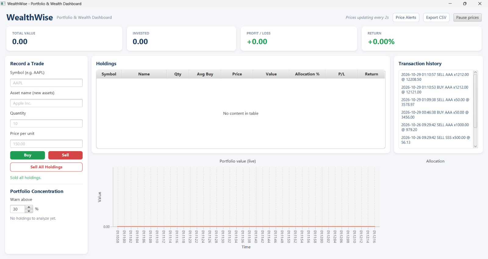
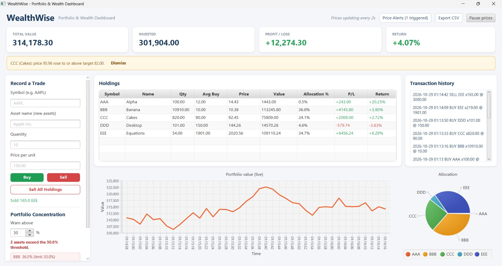
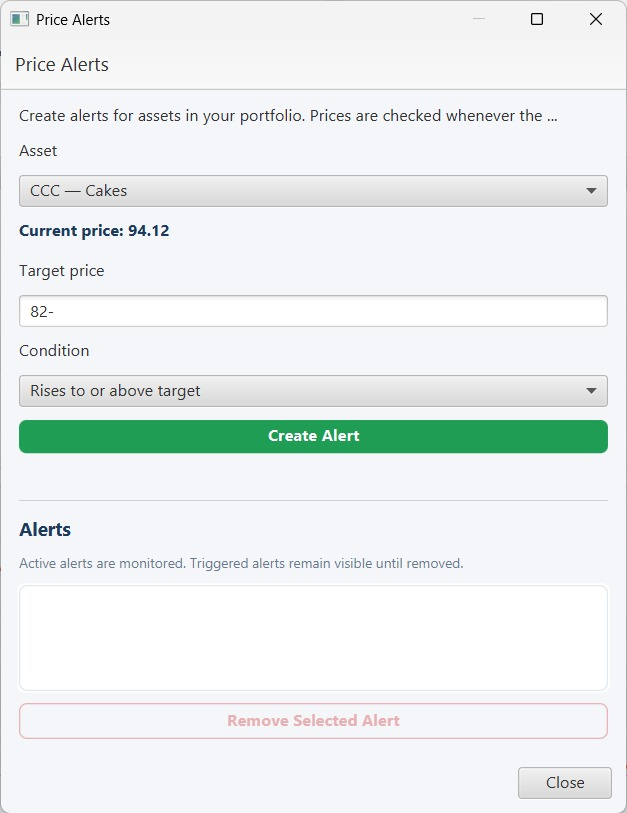
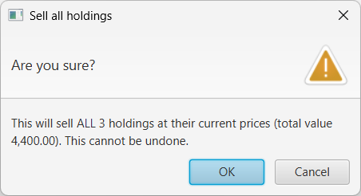

# WealthWise - Portfolio & Wealth Dashboard

WealthWise is a JavaFX desktop application for tracking a simulated investment portfolio. It lets you buy and sell assets, watch prices change, review concentration warnings, and keep data in a local SQLite database.

This project was built as a Semester 3 end-semester project for the course Advanced Java Programming.

## Features

- Buy and sell assets with input validation.
- Weighted-average buy price and protection against selling more than you own.
- Holdings table with quantity, prices, value, allocation, P/L, and return.
- Summary cards for total value, invested, profit/loss, and return.
- Background price simulator (2-second updates, pause/resume), value chart, and allocation pie chart.
- Price alerts with upward or downward targets, checked on each simulated price update and saved across restarts.
- Portfolio concentration panel that warns above a configurable threshold (default 30%).
- Transaction history, Sell All confirmation, and a scrollable sidebar for smaller windows.
- CSV export of the summary, holdings, allocation, and transactions; automatic saving to SQLite.

Prices are simulated, not real market data.

## Tech Stack

- Java 21
- JavaFX 21.0.5 (Controls and FXML)
- FXML and CSS interface
- SQLite via sqlite-jdbc 3.46.1.3
- Maven with javafx-maven-plugin 0.0.8
- JUnit 5 (Jupiter 5.10.2) for tests

The code is split into layers: `ui` (controllers, FXML), `service`/`model` (portfolio, alerts, concentration), `price` (simulator), `export` (CSV), and `db` (SQLite).

## Getting Started

### Prerequisites

- JDK 21
- Maven 3.9 or newer
- No separate database server is needed

Dependencies are downloaded by Maven.

### Installation

Clone the repository and build the project:

```bash
git clone https://github.com/gay3-dumb/WealthWise.git
cd WealthWise
mvn clean install
```

### Configuration

No configuration is required. On first launch the app creates `wealthwise.db` in the working directory; it stores holdings, transactions, and alerts and loads them automatically.

## Usage

Start the application from the project directory:

```bash
mvn javafx:run
```

Then:

1. Enter a symbol, optional asset name, quantity, and price; the name defaults to the symbol for a new asset.
2. Click Buy or Sell. Quantity and price must be positive, and you cannot sell more than you own.
3. Use Pause prices and Resume prices to control simulated updates.
4. Watch the table, summary cards, charts, and history update. Use Price Alerts to set an upward or downward target for a holding; each alert triggers once, shows a notification, and stays listed until removed.
5. Set the concentration threshold; assets above it are listed. The setting applies for this session.
6. Use Sell All Holdings to close every position at its current price after a confirmation dialog.

Use Export CSV to choose a location and save the summary, holdings, allocation, and transactions as a UTF-8 CSV with a byte-order mark for spreadsheet software. The app saves changes after trades and when the window closes.

## Screenshots

### Opening screen



### Portfolio with assets



### Price alert dialog



### Sell All confirmation



## Contributing

1. Create a branch for your change.
2. Make the change and keep it focused.
3. Run the tests:

   ```bash
   mvn test
   ```

4. Commit, push, and open a pull request into `main`.
