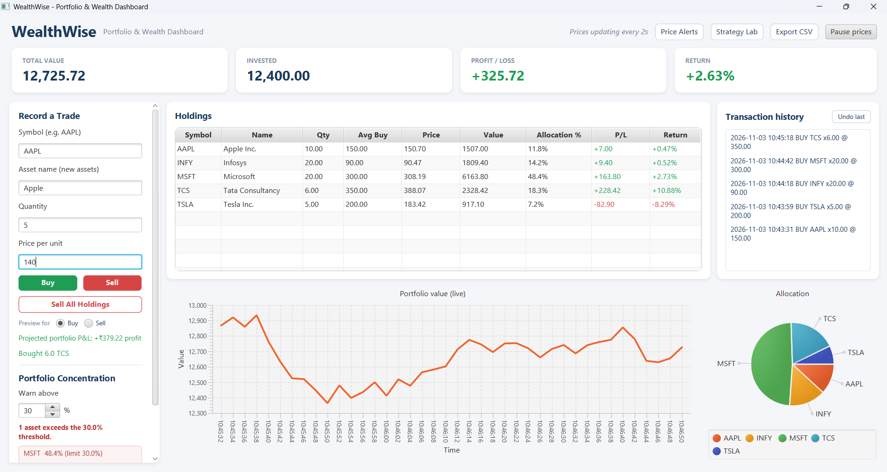
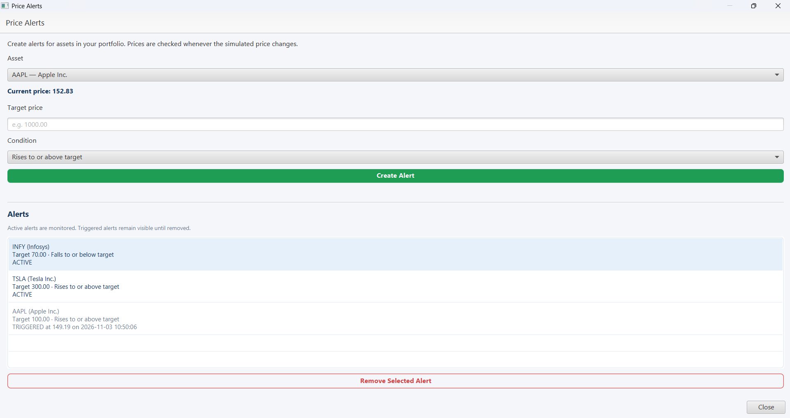
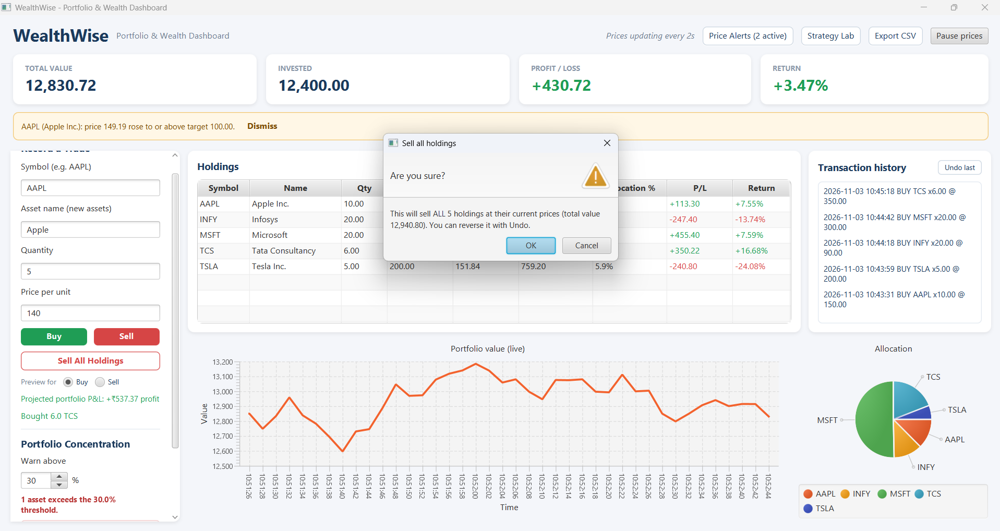
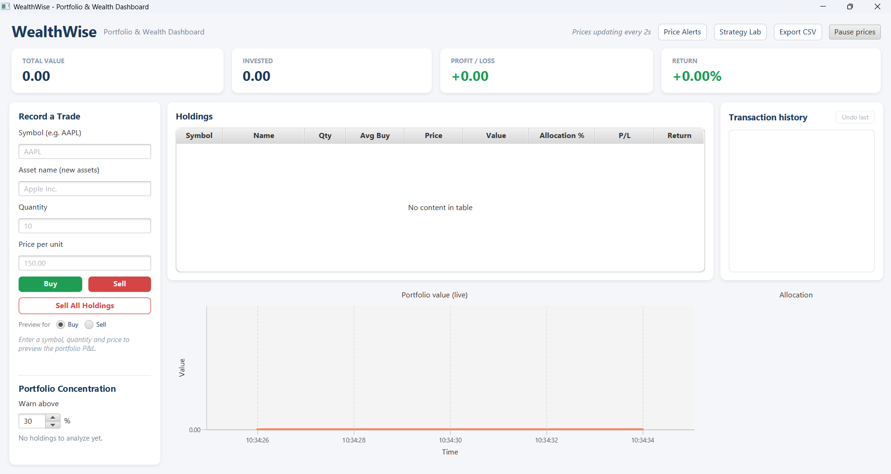
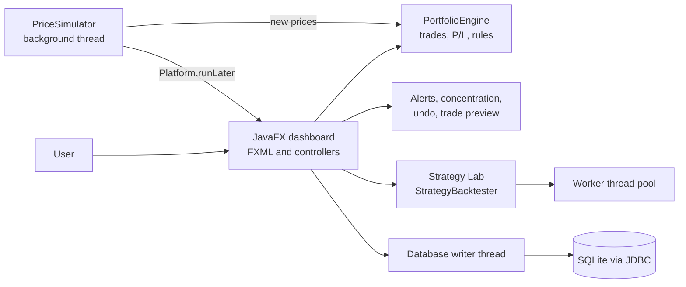
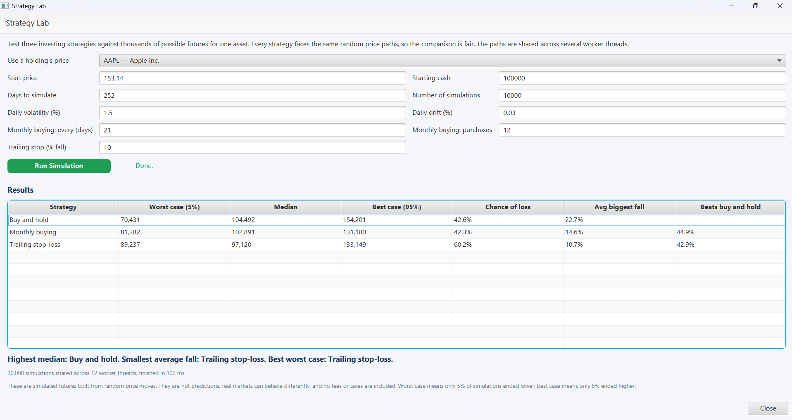

<h1 align="center">WealthWise</h1>

<p align="center">
  <strong>A multi-threaded JavaFX dashboard for tracking, stress-testing and understanding a simulated investment portfolio.</strong><br>
  Live prices. Risk warnings. Strategy backtesting. Everything saved locally.
</p>

<p align="center">
  <code>Java 21</code> &nbsp; <code>JavaFX 21</code> &nbsp; <code>SQLite</code> &nbsp; <code>JDBC</code> &nbsp; <code>Maven</code> &nbsp; <code>JUnit 5</code>
</p>

<p align="center">
  <a href="#features">Features</a> &nbsp; / &nbsp;
  <a href="#how-it-works">How it works</a> &nbsp; / &nbsp;
  <a href="#strategy-lab">Strategy Lab</a> &nbsp; / &nbsp;
  <a href="#getting-started">Getting started</a>
</p>

<p align="center">
  <br>
  <sub>The live dashboard: summary cards, holdings with allocation and P/L, transaction history, a value chart and an allocation pie chart.</sub>
</p>

WealthWise is a desktop application for learning how an investment portfolio behaves. Record buys and sells, watch simulated prices move in the background, get warned when too much of your money sits in one asset, set price alerts, and test investing strategies against thousands of possible futures before risking anything. Prices are simulated, never real market data.

Built as a Semester 3 end-semester project for **Advanced Java Programming**. The central Java concept is **multithreading**: a background price engine, a worker thread pool for simulations, and a safe hand-off from background threads to the JavaFX screen thread.

<table>
  <tr>
    <th width="50%">Price alerts</th>
    <th width="50%">Sell All confirmation</th>
  </tr>
  <tr>
    <td valign="top"></td>
    <td valign="top"></td>
  </tr>
  <tr>
    <td valign="top">Set an upward or downward target on any holding. Each alert triggers once and stays listed until removed.</td>
    <td valign="top">Closing every position shows how many holdings are affected and their total value, and needs a confirmation.</td>
  </tr>
</table>

<details>
<summary><strong>Empty start screen</strong></summary>



</details>

## Features

- **Trade with confidence.** Buy and sell with input validation, a weighted-average buy price, and protection against selling more than you own. A **trade preview** shows the projected portfolio profit or loss before you commit, **Undo last** reverses up to 50 actions, and **Sell All** asks for confirmation first.
- **Watch it move.** A background price simulator updates every 2 seconds (pause and resume at any time). The holdings table shows quantity, prices, value, allocation, P/L and return, next to a live value chart and an allocation pie chart.
- **Stay informed.** Price alerts notify you when a holding crosses a target. The concentration panel warns when any asset exceeds a threshold of your portfolio (30% by default, adjustable).
- **Test before you trust.** [Strategy Lab](#strategy-lab) runs thousands of simulated futures in parallel to compare investing strategies.
- **Keep your data.** Everything is saved automatically to a local SQLite database, and **Export CSV** writes the summary, holdings, allocation and transactions for spreadsheet software.

## How it works



The code is split into layers. Each package has one job, and the lower layers know nothing about the screen.

| Layer | Package | Responsibility |
|---|---|---|
| Window | `ui`, FXML, CSS | Buttons, tables, charts and dialogs. No business rules. |
| Model | `model` | `Holding`, `Transaction`, `PriceAlert` |
| Services | `service` | `PortfolioEngine`, `ConcentrationAnalyzer`, `PriceAlertService`, `TradePreview`, `UndoManager` |
| Price engine | `price` | `PriceSimulator`, a background price feed |
| Strategy Lab | `strategy` | `StrategyBacktester` and its configuration and result types |
| Export | `export` | `PortfolioCsvExporter` |
| Persistence | `db` | `DatabaseManager`, all JDBC and SQL |

### Threads

| Thread | What it does | Why it is separate |
|---|---|---|
| JavaFX Application Thread | Draws and updates the screen | The only thread allowed to touch UI controls |
| `price-simulator` | Moves prices every 2 seconds, then asks the screen to refresh | Prices keep changing without freezing the window |
| `db-writer` | Saves the portfolio to SQLite | Disk access never blocks the screen |
| `strategy-lab-worker` pool | Runs the simulated futures in parallel | Thousands of simulations finish quickly and the window stays responsive |

Background threads never touch the screen directly. They hand results over with `Platform.runLater(...)`. More detail is in the [architecture notes](docs/ARCHITECTURE.md).

### Project structure

```text
WealthWise/
├── pom.xml
├── screenshots/                     images used in this README
├── docs/                            architecture, usage and Strategy Lab guides
└── src/
    ├── main/java/com/wealthwise/
    │   ├── Main.java                application entry point
    │   ├── ui/                      controllers for the dashboard, alerts and Strategy Lab
    │   ├── model/                   Holding, Transaction, PriceAlert
    │   ├── service/                 portfolio rules, alerts, concentration, undo, trade preview
    │   ├── price/                   background price simulator
    │   ├── strategy/                Strategy Lab engine
    │   ├── export/                  CSV export
    │   └── db/                      SQLite access through JDBC
    ├── main/resources/com/wealthwise/ui/   FXML layouts and style.css
    └── test/java/com/wealthwise/    JUnit 5 tests that mirror the packages above
```

## Strategy Lab

Most apps show you what you own. Strategy Lab helps you decide **how to invest** by testing a strategy against thousands of possible futures first. Open it from the **Strategy Lab** button in the toolbar.



Every strategy faces the same random price paths, so the comparison is fair.

| Strategy | What it does |
|---|---|
| Buy and hold | Invest all the cash on day 0 and never touch it. The baseline. |
| Monthly buying | Split the cash into equal instalments and buy one every 21 days. |
| Trailing stop-loss | Invest everything on day 0, sell all if the price falls 10% from its peak, then stay in cash. |

With the default settings (100,000 starting cash, 252 days, 10,000 simulations), the results look like this:

| Strategy | Worst case (5%) | Median | Best case (95%) | Chance of loss | Avg biggest fall | Beats buy and hold |
|---|---:|---:|---:|---:|---:|---:|
| Buy and hold | 70,431 | 104,492 | 154,201 | 42.6% | 22.7% | n/a |
| Monthly buying | 81,282 | 102,891 | 131,180 | 42.3% | 14.6% | 44.9% |
| Trailing stop-loss | 89,237 | 97,120 | 133,149 | 60.2% | 10.7% | 42.9% |

Read it as a trade-off, not a winner: the stop-loss strategy gives up some upside for a smaller worst case and smaller falls, while buy and hold has the highest median and the widest range of outcomes.

The simulations are split into chunks and run on a fixed thread pool, and the same settings always give the same answer (the random seed is fixed). These are simulated futures, not predictions, and fees and taxes are not included. See the full [Strategy Lab guide](docs/STRATEGY_LAB.md).

## Getting started

### Prerequisites

- JDK 21
- Maven 3.9 or newer
- No separate database server is needed

### Install and run

```bash
git clone https://github.com/gay3-dumb/WealthWise.git
cd WealthWise
mvn clean install
mvn javafx:run
```

No configuration is required. On first launch the app creates `wealthwise.db` in the working directory and loads it automatically on later launches. Maven downloads the dependencies.

### Run the tests

```bash
mvn test
```

The suite has more than 80 JUnit 5 tests covering the portfolio rules, concentration analysis, price alerts, undo, trade preview, CSV export and Strategy Lab.

## Documentation

| Guide | What it covers |
|---|---|
| [Usage guide](docs/USAGE.md) | A walkthrough of every feature, step by step |
| [Strategy Lab guide](docs/STRATEGY_LAB.md) | Settings, results, how the simulation works and its limits |
| [Architecture notes](docs/ARCHITECTURE.md) | Layers, threading model, data flow and database tables |
